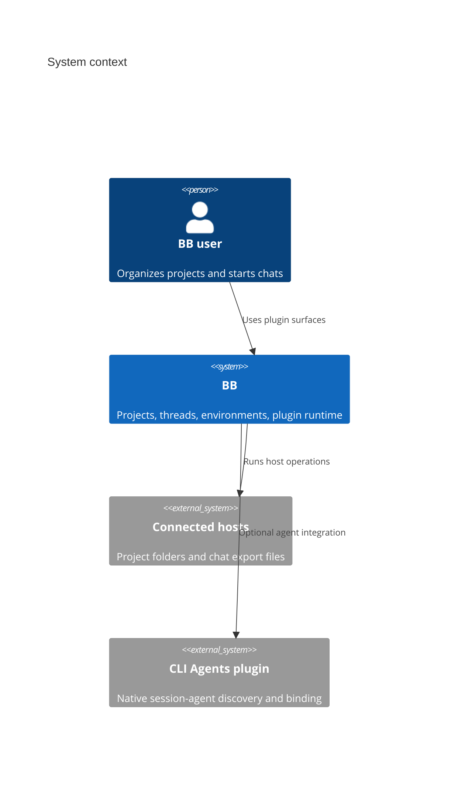
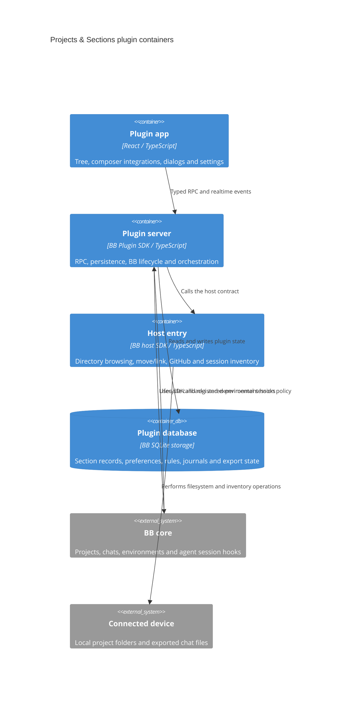
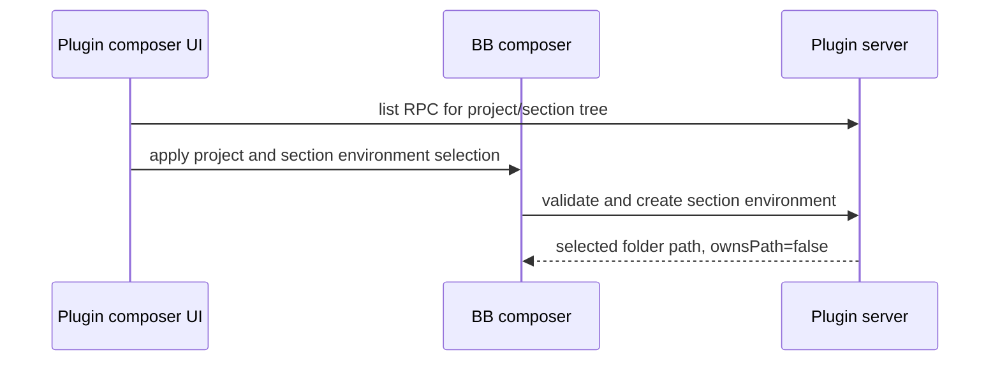
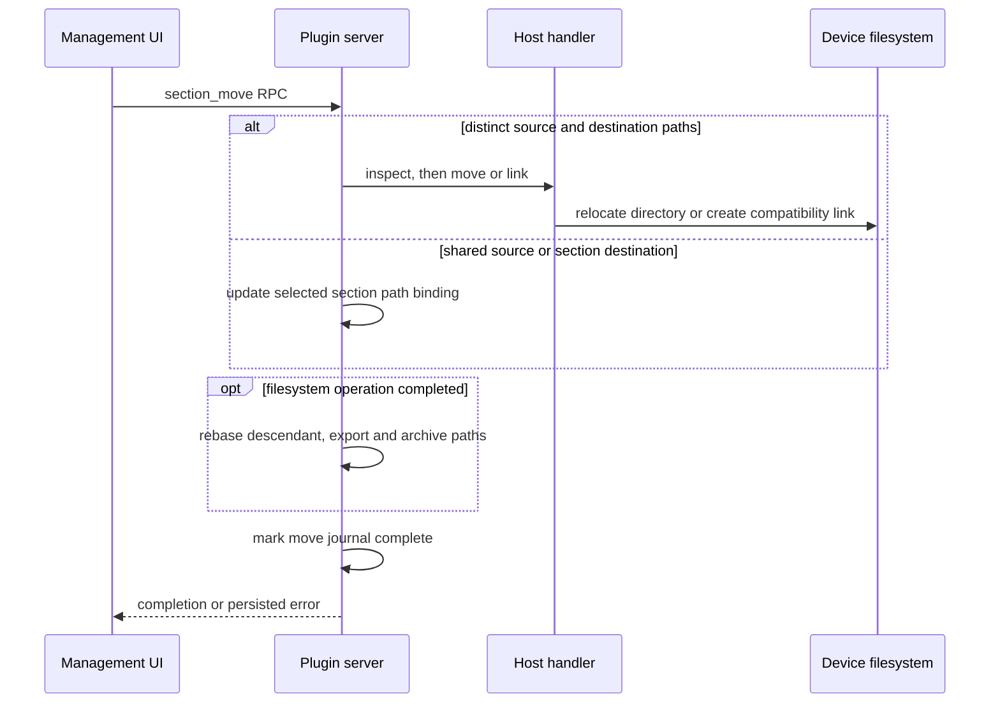

# Architecture

TL;DR: The React app calls the server through typed BB RPC; the server coordinates BB projects, threads, environments and storage, and dispatches filesystem-specific work to host handlers on connected devices (`server.ts:3392-3415`, `host.ts:7-16`).

## System Context

## Containers

## Building Blocks

- `app.tsx` composes the sidebar thread list, management page, composer extensions and settings sections (`app.tsx:1-70`). Its capabilities are covered by [the feature pages](features/project-tree.md).
- `server.ts` defines RPC schemas and handlers, initializes storage, integrates BB SDK lifecycle APIs and registers the CLI command (`server.ts:194-630`, `server.ts:650-771`, `server.ts:3582-3892`). See [API](api.md).
- `host.ts` binds the host contract to filesystem, move/link, GitHub remote and session inventory handlers (`host.ts:7-16`).
- State modules divide domain behavior: `archive.ts`, `section-remove.ts`, `project-move.ts`, `section-move.ts`, `thread-move.ts`, `execution.ts`, `session-policy.ts`, `session-policy-server.ts`, `preferences.ts` and `chat-list.ts` (`server.ts:1-59`).
- `export-queue.ts` coalesces queued history exports, runs one at a time and retries failures (`export-queue.ts:1-63`).
- `cache-keepalive.ts` schedules opt-in pings for eligible pinned Claude-family threads and persists idle/wake state plus the last ping-attempt timestamp (`server.ts:777-795`, `cache-keepalive.ts:93-135`, `cache-keepalive.ts:365-382`). See [Prompt cache keepalive](features/cache-keepalive.md).
- `auto-archive.ts` starts an initial sweep and hourly timer for configured quiet chats; the setting is off by default and stored in plugin preferences (`server.ts:796-809`, `auto-archive.ts:9-12`, `auto-archive.ts:175-189`). See [Section archive and restore](features/archive-and-restore.md#automatic-chat-archiving).
- `backup.ts` validates full plugin backups and imports/exports durable tables (`backup.ts:7-19`, `backup.ts:48-59`, `backup.ts:159-191`).

### Plugin initialization

1. `plugin(bb)` declares legacy rule-setting descriptors for migration, opens BB’s SQLite storage, and applies the plugin schema migrations for tree rows, rule records, move/archive/export state, preferences and keepalive state (`server.ts:650-771`).
2. It reads the migrated shared agent settings from `preferences`; if absent, it reads the legacy BB settings, validates each known value against its schema, stores the result, and logs a warning if legacy settings cannot be read (`server.ts:791-863`).
3. It defines the database-backed tree and rules helpers and constructs the move/archive/export subsystems; those helpers become dependencies of the RPC handlers (`server.ts:859-1060`, `server.ts:2062-2181`, `server.ts:3313-3363`).
4. It registers the main RPC contract and separate read-only section-list contract, then configures BB agent instructions and CLI commands (`server.ts:3582-3631`, `server.ts:3783-3892`).
5. Runtime integrations branch on BB capabilities: session policy enforcement is registered only when the experimental hook exists; unsupported/absent capability leaves stored policy available but unenforced (`session-policy-server.ts:52-75`, `session-policy-server.ts:151-157`).
6. The keepalive coordinator starts an initial sweep plus a one-minute interval; idle events update its per-thread state, and archive/delete events clear that state (`server.ts:772-790`, `cache-keepalive.ts:293-307`).
7. The auto-archive coordinator loads its preference, starts an initial sweep, and schedules hourly sweeps; plugin disposal clears the timer (`server.ts:796-809`, `auto-archive.ts:175-189`).

| Initialization branch | Condition | Outcome/failure |
|---|---|---|
| Legacy settings migration | No `preferences` row under `agents` | Attempts read, logs failure, validates defaults/values and stores one shared record (`server.ts:791-863`). |
| Existing settings | `agents` row exists | Parses saved JSON into defaults plus schema-valid values (`server.ts:791-838`). |
| Auto-archive setting | `auto_archive` row exists or is absent | Parse saved settings or use the disabled seven-day default (`server.ts:796-804`, `auto-archive.ts:9-30`). |
| Session-policy extension | BB provides `experimental_vkSessionPolicy` | Installs the resolver; otherwise capability is reported unavailable and no hook is installed (`session-policy-server.ts:52-75`, `session-policy-server.ts:151-157`). |
| RPC registration | Server finishes constructing `handlers` | Registers `rpcContract` with the full handler map, then registers `sectionsContract` with the `sections_list` handler and discoverable metadata (`server.ts:3548-3582`). |

## Key Flows

### Start a chat in a section

The registered section environment checks that the selected section exists, belongs to the chosen project, is not a group, has a folder binding on the selected host, and is not moving or being archived (`server.ts:3697-3757`).

### Move a section

For distinct paths, the move implementation checks relevant chats, records a journal before filesystem changes, drains pending exports, rechecks/stops chats, and updates folder, export and archive paths in a transaction; failures remain retryable. If the source path is shared or the destination already belongs to a section, it updates only the selected section’s path binding and completes the journal without a filesystem operation (`section-move.ts:197-252`, `section-move.ts:279-364`).

### Project relocation coordinator

`makeProjectMoves` creates a JSON journal reader/writer, a `busy` predicate for incomplete records, a canonical-path resolver and a host client. Its process-local `running` flag permits one move call at a time (`project-move.ts:18-46`).

1. The journal reader parses every `project_moves.data` value; the writer replaces a row keyed by journal ID. `busy(projectId)` reports any incomplete row for that project. `canonical(hostId, path)` repeatedly follows completed source-to-destination mappings on that host; it returns the first path with no matching mapping, and throws after 100 mapping steps (`project-move.ts:23-44`).
2. `move` rejects a concurrent attempt, then finds the BB project and its local-path source on the requested host. It reuses an incomplete journal only when host and destination match; otherwise it rejects the retry. With no pending journal, it creates a candidate from the current source and resolved destination (`project-move.ts:45-80`).
3. Preflight rejects overlapping project ownership, environments that cross the project root, unfinished archive work, invalid host paths, and active or queued chat work. It inventories archived and unarchived threads in pages of 200. After `checkThreads(false)` passes, it persists the journal, calls `changed`, drains pending exports, then runs `checkThreads(true)`, which checks each thread again and stops it if the busy-work guard passes (`project-move.ts:140-171`).
4. It asks the selected host to move the directory, updates the BB project source, rewrites matching archive manifests, and transactionally rebases section paths and export paths while marking the journal complete (`project-move.ts:172-233`).
5. A caught error is rethrown. If the journal was persisted, the handler records the error and publishes the changed state; `finally` releases the running guard (`project-move.ts:234-243`).

| Branch | Condition | Result |
|---|---|---|
| Busy | Another move is running | Rejects before project lookup (`project-move.ts:47-54`). |
| Retry | Incomplete journal matches host and destination | Reuses its original paths; a different destination/host is rejected (`project-move.ts:62-80`). |
| Preflight failure | Ownership, environment, archive, host path or thread checks fail | Rejects; if a journal already exists, records the error and preserves it for retry (`project-move.ts:81-171`, `project-move.ts:234-240`). |
| Complete | Host move and metadata updates succeed | Marks journal complete, clears error and returns it (`project-move.ts:172-233`). |
| Path canonicalization limit | The resolver follows 100 completed relocation mappings | Throws “Too many project relocation links” after the loop (`project-move.ts:34-44`). |

### Archive a section

The archive module inventories matching chats and files, saves chat exports, records an `archiving` journal, archives chats and moves files unless the section points outside the project, then removes tree/path rows and marks the record `archived`; operation failures keep the journal with an error (`archive.ts:119-240`, `archive.ts:322-375`).

## Invariants

- A group stores the synthetic path `@group/<id>`; the group creation handler labels it as non-filesystem state, and tree helpers treat groups as having no folder (`server.ts:2241-2249`, `section-tree.ts:8-11`).
- Section environment selection must match project and host and rejects groups or folders covered by an active move/archive (`server.ts:3697-3733`).
- Project, section and chat moves persist operation state so retries can resume without overwriting occupied destinations (`project-move.ts:26-31`, `section-move.ts:279-304`, `section-move.ts:254-277`, `thread-move.ts:108-136`).
- Chat history in BB remains canonical; exported files are snapshots written beneath the section folder (`server.ts:1803-1816`, `server.ts:1862-1872`).
- Session-context enforcement registers only when BB exposes the experimental extension (`session-policy-server.ts:52-75`, `session-policy-server.ts:151-157`).

## Cross-cutting concerns

RPC input/output shapes are Zod-backed contracts registered with BB’s plugin RPC service (`server.ts:194-630`, `server.ts:3582-3606`). The server publishes `changed` after state updates (`server.ts:1687`); the host entry separates device-specific operations from the central server (`host.ts:7-16`). Move and archive errors are persisted in journals; history export records errors and retries through a queue (`section-move.ts:358-364`, `archive.ts:371-375`, `export-queue.ts:27-45`).

<!-- lane-pilot:backlinks -->
## Referenced by

- [Projects & Sections — Overview](overview.md)
